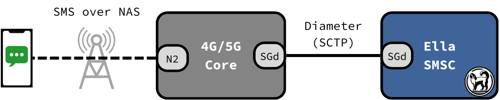
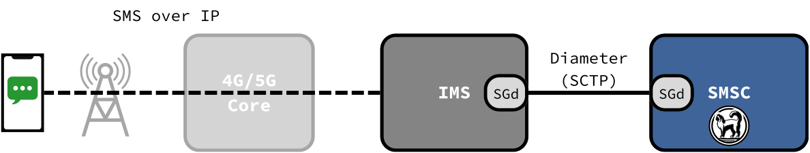
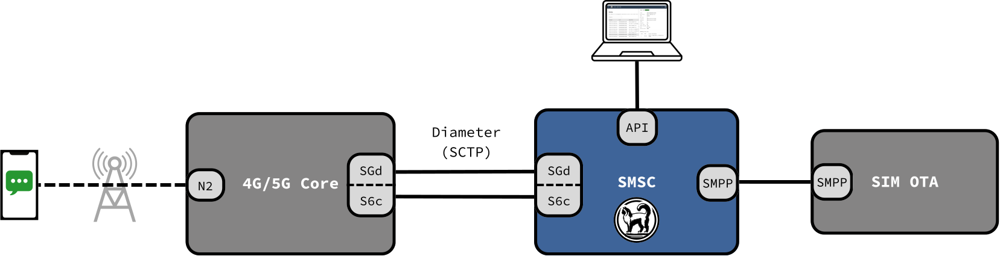

# Architecture

Ella SMSC is a Short Message Service Centre (SMSC) for private 4G and 5G networks. It stores the short messages sent to the network's subscribers, and delivers them when their phones can receive them.

Ella SMSC is a single application, with an embedded database, an embedded web UI, and an HTTP API.

## How phones send and receive SMS

A phone exchanges SMS with Ella SMSC in one of two ways: over NAS, through the core network, or over IP, through the IMS.

### SMS over NAS

<figure markdown="span">
  { width="800" }
  <figcaption>SMS over NAS</figcaption>
</figure>

With SMS over NAS, the message travels inside the signalling the phone already exchanges with the core network to attach and stay registered. It needs no IMS.

### SMS over IP

<figure markdown="span">
  { width="800" }
  <figcaption>SMS over IP</figcaption>
</figure>

With SMS over IP, the phone sends and receives its messages as SIP messages through the IMS. An IP Short Message Gateway (IP-SM-GW) in the IMS converts between SIP and short messages, and connects to Ella SMSC. [Ella IMS](https://docs.ellanetworks.com/ims/explanation/sms_over_ip/) includes an IP-SM-GW.

## Store and forward

1. Ella SMSC stores the message, and acknowledges it to the sender.
2. It asks the HSS where the recipient is served: an MME, an SMSF or an IP-SM-GW.
3. It sends the message there.
4. If the phone is unreachable, the HSS records that a message waits, and alerts Ella SMSC when the phone is back. Ella SMSC also retries after the [retry intervals](../reference/api/delivery.md).

Messages to a phone are delivered one at a time, in order.

A message ends delivered, failed, expired at the end of its validity period, or replaced by a later message. See [Statuses](../reference/api/messages.md#statuses).

## Messages from applications

Besides phones, applications can send messages to subscribers, for example notifications, one-time codes or updates to SIM cards. Ella SMSC offers them two interfaces:

- The [Messages API](../reference/api/messages.md): Ella SMSC's HTTP API, for applications you write or script.
- [SMPP](../reference/smpp.md): the standard SMSC protocol, for software that already speaks it, such as OTA platforms.

<figure markdown="span">
  { width="800" }
  <figcaption>OTA SIM delivery with SMPP</figcaption>
</figure>

## 3GPP roles

Ella SMSC integrates all three 3GPP functions:

| Function | Role | Diameter procedures (TS 29.338) |
| -------- | ---- | ------------------------------- |
| SC, Service Centre | Stores each message until it is delivered or expires. | |
| SMS-IWMSC | Receives the messages phones send (mobile originated, MO), and the HSS's alerts. | MO-Forward-Short-Message, Alert-Service-Centre |
| SMS-GMSC | Finds where a phone is served, and delivers messages to it (mobile terminated, MT). | Send-Routing-Info-for-SM, MT-Forward-Short-Message, Report-SM-Delivery-Status |
